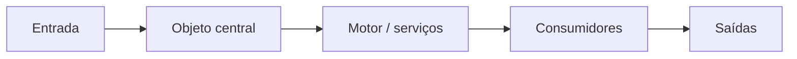
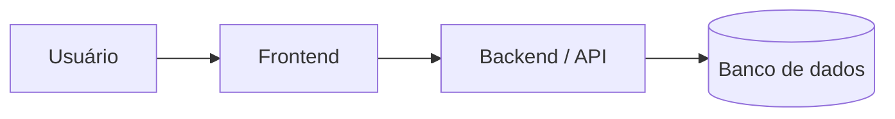

# Templates dos documentos de `docs/`

Use estes modelos como esqueleto. Preencha apenas com o que se sabe, marcando a certeza (✅ confirmado, 💡 hipótese, ❓ em aberto). Seção sem informação fica com **uma linha ❓**, nunca com texto de enchimento. Remova seções que não se aplicam ao projeto.

**Perfil e seções avançadas.** Estes são os modelos-base. O perfil do projeto (`perfis.md`) decide quais **seções avançadas** de `templates-avancados.md` entram (catálogo de funcionalidades, matriz de permissões, transições de estado, dicionário de dados, inventário de integrações, segurança, navegação, estados de interface, tokens em camadas). **IDs:** `FEAT-01`, `RN-01`, `E-01`, `SCR-01`, `API-01`, `INT-01`, tarefa `fase.tarefa`, `TEST-01` (ver `perfis.md`).

## Sumário
1. Cabeçalho comum
2. PRODUTO.md
3. NEGOCIO.md
4. ARQUITETURA.md
5. DESIGN.md
6. TASKS.md
7. ESTADO.md
8. DECISOES.md
9. Spec de tarefa (`docs/tarefas/<id>.md`)
10. VISAO.md (mapa do todo; criado depois do relatório do plano)

---

## 10. VISAO.md

Mapa permanente do projeto: como as partes se encaixam. Vem do relatório do plano aprovado (`relatorio-plano.md`, itens 2, 3 e 7). Curto (cabe em duas telas); o detalhe fica nos outros documentos. Emoji de título: 🗺️.

```markdown
## 1. Objeto central
<A "coisa" de que o resto deriva, de onde nasce e o que o usuário pode ajustar sem perder o calculado.> ✅/💡

## 2. Camadas e fluxo de dados

<Uma linha por camada: o que faz, onde vive no código, status (✅ feito · 🔄 parcial · ⬜ não iniciado).>

## 3. O que depende do quê
<Ordem de construção em poucas linhas, ex.: "telas (fase 4) dependem do modelo e do motor (fases 3 e 5)".>

## 4. Matriz de cobertura
| Regra (RN) | Camada | Tarefas | Testes (perfil 3 e regras críticas) |
|---|---|---|---|
| RN-01 | | 2.0, 2.1 | TEST-01 |

## 5. Como a estrutura foi organizada (só reestruturação)
<De onde veio cada coisa: o que foi movido, mesclado ou preservado, com a data.>
```

---

## 1. Cabeçalho comum (todos os documentos)

```markdown
# 🎯 <Título>: <NomeDoProjeto>
> Uma frase com a proposta de valor (ou o propósito do documento).

| Versão | Atualizado em | Status | Fase atual |
|---|---|---|---|
| 0.1 | AAAA-MM-DD | 📝 Rascunho | <fase> |

Legenda: ✅ confirmado · 💡 hipótese · ❓ em aberto
```

Emojis de título sugeridos: 🎯 Produto · 🧩 Negócio · 🏛️ Arquitetura · 🎨 Design · ✅ Tasks · 🧠 Estado · 📜 Decisões.

---

## 2. PRODUTO.md

```markdown
## 1. Visão geral
<2 a 3 frases: o que é, para quem, qual o resultado.> ✅/💡

## 2. Problema
<Qual dor, de quem, com que frequência.> ✅/💡

## 3. Público
| Perfil | Contexto de uso | Dispositivo | Nível técnico | Necessidade principal | Certeza |
|---|---|---|---|---|---|

## 4. Proposta de valor e diferencial
<Por que trocariam pela solução nova.> 

## 5. Concorrência e alternativas
| Alternativa | O que faz bem | Onde falha | Certeza |
|---|---|---|---|

## 6. Funcionalidades do MVP
(Perfil 2 e 3: use o catálogo por módulo de `templates-avancados.md`, seção 1.1, com prioridade MVP / pós-MVP / futuro / fora de escopo.)
| # | Funcionalidade | Prioridade | Certeza |
|---|---|---|---|
| FEAT-01 | | 🔴 Alta | |

## 7. Fora do escopo (por enquanto)
- 

## 8. Métricas de sucesso
(Perfil 2 e 3: separe objetivo de negócio, do usuário e funcional; ver `templates-avancados.md`, seção 1.2. Meta sem dados: "a definir" ❓.)
| Métrica | Meta | Como medir | Certeza |
|---|---|---|---|

## 9. Requisitos não funcionais
| Área | Meta mensurável | Certeza |
|---|---|---|
| Performance | ex.: carregar em menos de 3 s no 4G | 💡 |
| Acessibilidade | ex.: WCAG 2.1 AA | 💡 |
| Segurança | ex.: validação em cliente e servidor | 💡 |

## 10. SEO (somente se o projeto for público)
| Página principal | Termos que o cliente quer ranquear | Metadados | Certeza |
|---|---|---|---|
```

---

## 3. NEGOCIO.md

```markdown
## 1. Fluxos de usuário
### Fluxo: <nome> (ator: <quem>)
1. <passo>
2. <passo>
**Desvios e exceções:** <o que pode dar errado e o que acontece>
**Certeza:** ✅/💡

## 2. Regras de negócio
| ID | Regra | Origem | Certeza |
|---|---|---|---|
| RN-01 | <ex.: pedido só pode ser cancelado antes do envio> | <quem disse / arquivo> | ✅ |

## 3. Modelo de domínio
(Papéis, matriz de permissões, organizações, transições de estado, dicionário de dados e regras de persistência: seções avançadas em `templates-avancados.md`, seção 2. Banco é condicional: só se o projeto tiver.)
| ID | Entidade | Campos principais | Status possíveis | Certeza |
|---|---|---|---|---|
| E-01 | <Pedido> | id, cliente, itens, total | pendente, enviado, entregue, cancelado | 💡 |

**Relações:** <Cliente 1:N Pedido; Pedido 1:N Item; ...>

(Opcional: diagrama Mermaid `erDiagram`.)
```

---

## 4. ARQUITETURA.md

````markdown
## 1. Visão geral
<Como as partes se conectam, em 2 a 4 frases.>



## 2. Stack
| Camada | Tecnologia | Versão | Propósito | Certeza |
|---|---|---|---|---|
| Frontend | | | | |
| Backend | | | | |
| Banco | | | | |
| Estilo | | | | |
| Autenticação | | | | |
| Hospedagem / deploy | | | | |

(Versões lidas de manifestos: ✅. Sugeridas pela skill: 💡.)

## 3. Estrutura de pastas
```text
<árvore comentada, só os níveis que importam>
```
Regra: não criar pastas novas sem registrar aqui.

## 4. Integrações externas
(Perfil 2 e 3: inventário detalhado `INT-nn`, segurança, ambientes e migrações em `templates-avancados.md`, seção 3.)
| Serviço | Para quê | Configuração | Certeza |
|---|---|---|---|

## 5. Comandos
- Instalar: `...` · Rodar: `...` · Testar: `...` · Lint: `...` · Build: `...`
```
Decisões de arquitetura e seus motivos ficam em `DECISOES.md`, não aqui.
````

---

## 5. DESIGN.md

```markdown
## 1. Princípios de UX
- <ex.: simples e direto; foco no conteúdo; consistente> 

## 2. Contexto de uso
<Quem usa, onde, em que situação (celular em movimento? balcão?).> 

## 3. Mobile-first
- Projetar a partir de ~360 px; ampliar com `md:` e `lg:`.
- Áreas de toque de 44 px; sem dependência de *hover*; navegação ao alcance do polegar.
- Cada tela prevê estados: vazio, carregando, erro, sucesso.
- Tom de voz dos textos: <...>

## 4. Mapa de telas
(Antes do mapa, perfil 2 e 3: navegação, estados da interface, responsividade e patterns/templates em `templates-avancados.md`, seção 4.)
| ID | Tela | Fluxo | Prioridade | Tarefa | Status |
|---|---|---|---|---|---|
| SCR-01 | | | 🔴 | | ⬜ Não iniciada |

Ficha opcional por tela (quando valer a pena): objetivo em uma frase · quem acessa e de qual fluxo vem · ações principais e secundárias · link do frame no Figma.

## 5. Design system
- **Origem:** <Figma (link) | pacote/caminho no código | gerado a partir do logo | configuração mínima>
- **Tokens:** <caminho do `tailwind.config` ou do CSS com `@theme`>
- **Regra de ouro:** usar apenas tokens e componentes existentes; nada de cor ou espaçamento avulso.

### Paleta (legível; a fonte oficial é o código/Figma)
| Papel | Nome | Valor | Uso |
|---|---|---|---|
| Primária | | | Botões, links, estados ativos |
| Secundária | | | Ações secundárias, destaques |
| Sucesso / Alerta / Erro | | | Mensagens e estados |
| Fundo | | | Páginas |

### Tipografia
| Papel | Família | Tamanho | Peso |
|---|---|---|---|

### Componentes
| Componente | Variantes | Onde fica |
|---|---|---|
| Botão | primário, secundário, destrutivo | |

## 6. Referências
- Figma: <links> · Apps de referência: <...> · Identidade da marca: <...>
```

---

## 6. TASKS.md

```markdown
> **Total** N · **Concluídas** X (Y%) · **Em andamento** Z

## Fase 1: Setup
| # | Tarefa | Itens | Cobre (RN/camada) | Prioridade | Status | Pronto quando | Concluída em |
|---|---|---|---|---|---|---|---|
| 1.1 | | — | — | 🔴 | ⬜ Não iniciada | | — |

## Fase 2: <Dados e autenticação / API>
| # | Tarefa | Itens | Prioridade | Status | Pronto quando | Concluída em |
|---|---|---|---|---|---|---|
| 2.0 | Fundação: <padrão de rotas, erros, validação, autenticação> | — | 🔴 | ⬜ Não iniciada | | — |
| 2.1 | <Módulo de acesso: cadastro, login, sessão> | E-01 | 🔴 | ⬜ Não iniciada | | — |

## Fase 3: Telas
| # | Tarefa | Itens | Prioridade | Status | Pronto quando | Concluída em |
|---|---|---|---|---|---|---|
| 3.0 | Fundação visual: tokens e componentes base | — | 🔴 | ⬜ Não iniciada | Botão, campo, cartão e navegação no padrão do design system | — |
| 3.1 | <Fluxo de acesso> | SCR-01, SCR-02, SCR-03 | 🔴 | ⬜ Não iniciada | 360 px, 4 estados, revisada e testada no celular | — |
```

Dependências entram no "Pronto quando" como "Depende de 2.0". Status: ✅ Concluída · 🔄 Em andamento · ⬜ Não iniciada · ⏸️ Bloqueada. Os contadores do topo são **recalculados a partir das tabelas** a cada conclusão; nunca digitados à mão. Detalhes de agrupamento em `tarefas-e-fases.md`. Quando a tarefa tem spec (`docs/tarefas/<id>.md`), o "pronto quando" diz "ver spec" e os critérios vivem lá, sem duplicar.

---

## 7. ESTADO.md

```markdown
> **Atualizado** AAAA-MM-DD · **Fase** N (<nome>) · **Progresso** X/N (Y%)

## 🎯 Onde estamos
- ✅ <o que está pronto, em frases curtas>
- 🔄 <o que está em andamento (IDs das tarefas)>

## ➡️ Próximos passos
1. <próxima tarefa, com ID>

## ⚠️ Atenção
- <armadilhas que pegam o projeto de surpresa: variável de ambiente necessária, serviço instável, etc.>

## ❓ Pendências em aberto
- <decisões do cliente ainda não tomadas>
```

Arquivo **curto** (cabe em uma tela), **reescrito inteiro** a cada tarefa concluída. Não lista tarefas: referencia IDs de `TASKS.md`, que é a única fonte das tarefas.

---

## 8. DECISOES.md

```markdown
## AAAA-MM-DD: <título da decisão>
- **Contexto:** por que surgiu
- **Decisão:** o que ficou definido
- **Alternativas descartadas:** e por quê
- **Tarefa relacionada:** <ID>
- **Status:** ✅ Confirmada · 💡 Proposta · ❓ Pendente · 🚫 Descartada (com o motivo)
- **Certeza da origem:** ✅ dita pelo usuário / 💡 inferida do código
```

Log que **só acrescenta**: nunca reescreva o passado; se uma decisão mudar, acrescente uma entrada nova que a substitui e cite a anterior.

---

## 9. Spec de tarefa (`docs/tarefas/<id>.md`)

Criada sob demanda, para tarefas grandes ou ambíguas (ver `tarefas-e-fases.md`). Escreva as seções 1 a 4 **sem citar tecnologia**; o "como" só aparece na seção 5, depois que as dúvidas forem resolvidas.

```markdown
# 🧪 Spec da tarefa <ID>: <título>

| Tarefa | Itens | Fase | Status | Atualizado em |
|---|---|---|---|---|
| <ID> | <SCR-01, SCR-02 / E-01 ...> | <fase> | 🔄 Em andamento | AAAA-MM-DD |

## 1. Objetivo
Como <ator>, quero <ação>, para <resultado>.

## 2. Critérios de aceite (verificáveis)
- [ ] CA1: Dado <contexto>, quando <ação>, então <resultado observável>.
- [ ] CA2: ...

## 3. Fora do escopo desta tarefa
- 

## 4. Dúvidas a esclarecer
| # | Pergunta | Resposta | Certeza |
|---|---|---|---|
| 1 | | | ❓ |

## 5. Plano (como)
- Módulos e arquivos afetados:
- Abordagem:
- Riscos e dependências:

## 6. Subtarefas
- [ ] <ID>a: 
- [ ] <ID>b: 

## 7. Verificação
- Automática: <testes que cobrem quais critérios>
- Manual: <o que o usuário confere, e onde (celular, navegador)>

## 8. Resultado (preencher ao concluir)
- O que foi feito:
- Desvios em relação à spec:
- Decisões novas (registradas em DECISOES.md):
```

Cada critério de aceite deve ser observável e testável; se não der para verificar, reescreva até dar. Critérios que dependem de regra de negócio citam o ID da regra (RN-03).
